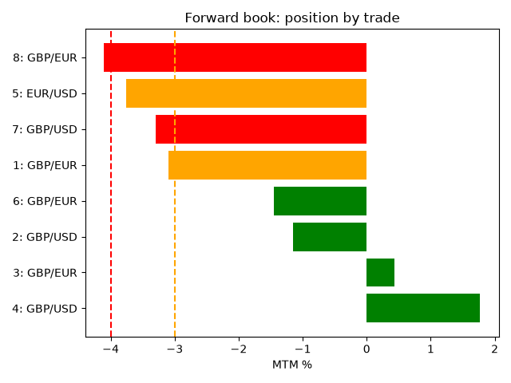

# FX Forward Margin Monitor

A small Python tool that marks a book of open FX forwards to market and flags
positions that are close to, or past, a margin trigger.

I built it to monitor a live forward book at an FX and payments firm. The trades
in this repository are made up.

## What it does

For each open forward it:

1. Works out the time left to settlement
2. Builds a forward rate for the settlement date from spot and the two
   currencies' interest rates
3. Marks the trade against that forward rate, not spot
4. Converts the profit or loss into pounds
5. Applies a margin policy and gives a decision: No Action, Warning or Margin Call
6. Flags any trade within 0.10% of a trigger, so it can be checked against a
   live forward quote

It then reports the whole book, sorted from most offside to most onside, with
total notional, total mark-to-market and the book's overall position, and saves
a chart of every trade against the margin triggers.

## How the marking works

    forward = spot x (1 + quote rate x t) / (1 + base rate x t)

    P&L in quote currency = base amount x (contract rate - forward) x side
    P&L in base currency  = P&L in quote currency / forward
    position %            = P&L in base currency / base amount

`side` is +1 if the client buys the quote currency and -1 if they sell it.

The tool handles any pair, not only pairs against the pound. Each trade names
its base currency, cross rates are derived from the two pound rates, and all
results are converted into pounds for the book totals.

## Margin policy

Set in `decide()`:

- New clients: margin call at 3% offside
- Established clients: warning at 3% offside, margin call at 4%

## Running it

    pip install -r requirements.txt
    python margin_monitor.py

The book is read from `sample_book.csv`. Spot rates and interest rates are set
at the top of `margin_monitor.py`.

## Example output

     row    pair  notional_gbp   pnl_gbp  mtm_pct    decision     check
       8 GBP/EUR     569176.88 -23330.52    -4.10 Margin Call Live Rate
       5 EUR/USD     346080.89 -12970.92    -3.75     Warning
       7 GBP/USD     735294.12 -24207.64    -3.29 Margin Call
       1 GBP/EUR     325379.61 -10066.75    -3.09     Warning Live Rate
       6 GBP/EUR      72340.43  -1046.19    -1.45   No Action
       2 GBP/USD     375234.52  -4307.09    -1.15   No Action
       3 GBP/EUR     210084.03    893.71     0.43   No Action
       4 GBP/USD    2425373.13  43023.48     1.77   No Action

## Chart

The tool also saves a chart of the book as `book_chart.png`.

One bar per trade, most offside at the top. Green is No Action, orange is Warning
and red is Margin Call. The dashed lines mark the 3% and 4% triggers. A new client
can be red before the 4% line, because their margin call level is 3%.

## Notes and limits

- Interest rates are central bank policy rates, used as a stand-in for market
  term rates. Checked against live forward quotes, the tool's forward rates
  were within 1 to 5 pips, which is why trades near a trigger are flagged for
  a manual check.
- Spot rates are entered by hand.

## Next steps

- Load the dealing platform's export directly